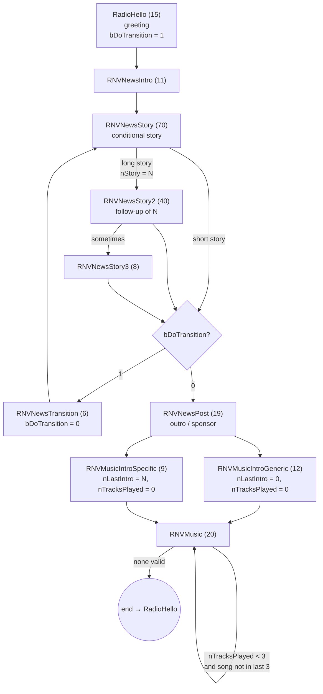

# How Radio New Vegas works under the hood

[Versión en español](../es/como-funciona-radio-new-vegas.md)

This document explains, from the game's own data (`FalloutNV.esm`, `Fallout - Voices1.bsa`, `Fallout - Sound.bsa`), how Fallout: New Vegas builds its Radio New Vegas station, and how this program reproduces it. Everything taken from the ESM is exact; deductions are marked **[inference]**.

---

## 1. Summary

Radio New Vegas is not a playlist: it is **a looping conversation** of a *Talking Activator* (Mr. New Vegas) whose lines are chained through conditional dialogue and seven control variables. The resulting cycle is:

```
Greeting → News intro → Story 1 (+0–2 follow-up lines) → Transition
         → Story 2 (+0–2 follow-up) → News outro / sponsor
         → Music intro ─┬─ generic  → 3 songs in a row
                        └─ specific → 1 song (the announced one)
         → (end of conversation) → starts again with a Greeting
```

Key rule: **a song never plays if it is among the last 3 played** (the history carries over between blocks).

---

## 2. Where everything lives in the game files

| What | Where | Notes |
|---|---|---|
| Radio logic | `FalloutNV.esm` → QUST `RadioNewVegas` (0x0014DF04) | Script `RadioNewVegasSCRIPT` holds the variables |
| Broadcaster | TACT `RadioNewVegasTA` (0x0014DF02) | Voice type `MaleUniqueMrNewVegas`. No *radio template* (no audio filter) |
| Dialogue | 12 DIAL records of type **Radio** (type 7) + their INFOs | 216 INFOs: 196 spoken lines + 20 songs |
| Songs | `Data\Sound\songs\radionv\*.mp3`, also inside `Fallout - Sound.bsa` | Folder shared with other stations (48 mp3). RNV uses 19 |
| Spoken lines | `Fallout - Voices1.bsa` → `sound\voice\falloutnv.esm\maleuniquemrnewvegas\` | |
| Interviews (Swank, Primm Slim, Meyers…) | Same BSA, in each NPC's voice type folder (`maleadult03`, `robotprotectron`…) | Same naming pattern |

### Audio formats

| | Format | Details |
|---|---|---|
| Songs | MP3 | 256 kbps CBR, 44.1 kHz, stereo (two Dead Money tracks at 192 kbps). The BSA also ships a `*_mono.ogg` copy of each one for in-world radios |
| Spoken lines | Ogg Vorbis | 24 kHz, mono, ~46 kbps. Each comes with a `.lip` (lip-sync) file |

Songs are mastered much quieter than the voices (−28 to −34 LUFS vs −13 to −16 LUFS), and almost all of them end with 3–8 s of digital silence. The game plays them as they are.

### Voice file names

`<quest>_<topic>_<INFO FormID, 8 hex digits>_<response number>.ogg`

When `len(quest) + len(topic) > 25`, the engine truncates the quest to 10 characters and the topic to 15:

- `radionewvegas_rnvnewsstory_0014e7cd_1.ogg`
- `radionewve_rnvmusicintroge_0014eb17_1.ogg` (← `RadioNewVegas` + `RNVMusicIntroGeneric`)

Matching by FormID (`*_0014eb17_1.ogg`) is the most robust approach, and is what the program does.

---

## 3. How the game engine runs it

1. A Talking Activator with the *Radio Station* flag broadcasts continuously: when a conversation ends, a new one starts at the **`RadioHello`** topic (shared by every radio; each INFO belongs to one quest).
2. Each line (INFO) has:
   - **Conditions** (`CTDA`): quest variables, story globals (`VStoryEvent*`), quest stages, dead NPCs, perks.
   - **Choices** (`TCLT`): topics that may come next.
   - **Result script**: updates the control variables once the line has played.
   - **Flags**: `Random` (pick at random among the topic's valid lines), `RandomEnd`, `RunImmediately`.
   - For songs, `TRDT` points to a SOUN record (the mp3) instead of a voice file, and the text is the song title.
3. After each line the choices are evaluated; among the topics with at least one valid line one is picked and, inside it, a random line (`Random` topic) or the first valid one.
4. When no choice has valid lines, **the conversation ends** and the station goes back to step 1.

**[inference]** When two choices are valid at the same time (e.g. `RNVMusicIntroGeneric` and `RNVMusicIntroSpecific`) one is picked at random: if the first one always won, specific song intros would never play, and they do play in the game.

### Control variables (`RadioNewVegasSCRIPT`)

| # | Variable | Purpose |
|---|---|---|
| 1 | `nStory` | Current "long" story → selects its follow-up in Story2/Story3 |
| 2 | `bDoTransition` | 1 = transition to a 2nd story; 0 = close the news block |
| 3 | `nLastIntro` | 0 = generic intro; N = song N was announced |
| 4–6 | `nLastTrack1..3` | Last 3 songs played |
| 7 | `nTracksPlayed` | Songs in a row in this block (max 3) |
| 8 | `bKimballMOD` | How President Kimball died (only used by the news) |

---

## 4. Topic graph



Numbers in brackets are line counts. `RNVDamStory`/`RNVDamOutro` are the Hoover Dam battle reports, linked from a story that requires `VStoryState >= 60`.

| Topic | Lines | Condition to play | Next | Effect |
|---|---|---|---|---|
| `RadioHello` | 15 | — (1 needs the *Wild Wasteland* perk) | NewsIntro | `bDoTransition = 1` |
| `RNVNewsIntro` | 11 | — | NewsStory | — |
| `RNVNewsStory` | 70 | Game state (§6) | Transition/Post, or Story2 | 33 set `nStory = N` |
| `RNVNewsStory2` | 40 | `nStory == N` (first valid) | Transition/Post, or Story3 | `nStory = 0` |
| `RNVNewsStory3` | 8 | `nStory == N` | Transition/Post | `nStory = 0` |
| `RNVNewsTransition` | 6 | `bDoTransition == 1` | NewsStory | `bDoTransition = 0` |
| `RNVNewsPost` | 19 | `bDoTransition == 0` (2 need *Wild Wasteland*) | IntroGeneric or IntroSpecific | — |
| `RNVMusicIntroGeneric` | 12 | — | Music | `nLastIntro = 0`, `nTracksPlayed = 0` |
| `RNVMusicIntroSpecific` | 9 | Announced song not in last 3 | Music | `nLastIntro = N`, `nTracksPlayed = 0` |
| `RNVMusic` | 20 | `nTracksPlayed < 3` **and** id ∉ {last 3} **and** (`nLastIntro == id` **or** `nLastIntro == 0`) | Music | `nTracksPlayed += 1`, shifts the history |

Consequences:

- **There are always exactly 2 stories per block**: the transition is only valid the first time.
- **Generic intro → 3 random songs**, none of the last 3.
- **Specific intro → only the announced song plays**: `nLastIntro` keeps the value N and no other song meets the condition, so the conversation ends. Instrumentals can only follow a generic intro, which is why the 9 songs with their own intro play more often (~6.3% each vs ~3.9%).
- The 7 sponsor lines (Tops, Silver Rush, Primm, Gomorrah, Ultra-Luxe, Vikki & Vance, Vault 21) live inside `RNVNewsPost`.
- There is no time of day and no "Say Once": spoken lines repeat often.

---

## 5. Songs

Internal IDs from the result scripts (11, 14, 15, 17 and 20 are missing: the system was built for 25).

| ID | Song | Artist | File | Length | Own intro |
|---|---|---|---|---|---|
| 1 | Ain't That a Kick in the Head | Dean Martin | `mus_aint_that_a_kick_in_the_head.mp3` | 2:26 | yes |
| 2 | Blue Moon | Frank Sinatra | `mus_blue_moon.mp3` | 2:52 | yes |
| 3 | Jingle, Jangle, Jingle | Kay Kyser Orchestra | `mus_jingle_jangle_jingle.mp3` | 3:20 | yes |
| 4 | Love Me as Though There Were No Tomorrow | Nat King Cole | `mus_love_me_as_though_no_tomorrow.mp3` | 2:35 | yes |
| 5 | Mad About the Boy | Helen Forrest | `mus_mad_about_the_boy.mp3` | 2:09 | yes |
| 6 | Something's Gotta Give | Bing Crosby | `mus_somethings_gotta_give.mp3` | 2:02 | yes |
| 7 | Johnny Guitar | Peggy Lee | `mus_johnny_guitar.mp3` | 3:03 | yes |
| 8 | It's a Sin to Tell a Lie | The Ink Spots | `mus_its_a_sin_to_tell_a_lie.mp3` | 2:21 | yes |
| 9 | Heartaches by the Number | Guy Mitchell | `mus_heartaches_by_the_number.mp3` | 2:34 | yes |
| 10 | Why Don't You Do Right? | Peggy Lee | `mus_why_dont_you_do_right.mp3` | 3:22 | no |
| 12 | American Swing | Gerhard Trede | `mus_american_swing.mp3` | 1:35 | no |
| 13 | Hallo Mister X | Gerhard Trede | `mus_hallo_mister_x.mp3` | 2:10 | no |
| 16 | Manhattan | Gerhard Trede | `mus_manhattan.mp3` | 1:22 | no |
| 18 | Sit and Dream | Pete Thomas | `mus_sit_and_dream.mp3` | 1:30 | no |
| 19 | Slow Bounce | Gerhard Trede | `mus_slow_bounce.mp3` | 2:05 | no |
| 21 | Strahlende Trompete | Gerhard Trede | `mus_strahlende_trompete.mp3` | 3:07 | no |
| 22 | Von Spanien nach Südamerika | Gerhard Trede | `mus_von_spanien_nach_s_damerika.mp3` | 1:46 | no |
| 23 | Where Have You Been All My Life | Jeff Hooper | `mus_where_have_you_been_all_my_life.mp3` | 2:57 | no |
| 24 | Big Iron | Marty Robbins | `mus_big_iron.mp3` | 3:58 | no |
| 25 | Stars of the Midnight Range | Johnny Bond | ⚠ points to `mus_big_iron.mp3` | — | no |

⚠ **Vanilla bug**: the *Stars of the Midnight Range* INFO uses *Big Iron*'s sound, so in the game *Big Iron* plays twice as often. The right mp3 exists (Mojave Music Radio uses it). The program can fix it or keep it.

---

## 6. News and game state

The 70 stories in `RNVNewsStory` depend on what the Courier has done:

- **`VStoryEvent*` globals** (Hanlon, Kings, Fiends, PrimmSheriff, CaesarKilled, Kimball, BoS, Nelson, Remnants, Racket, MrHouseNeutralized…): 0 = has not happened, 1/2/3 = different outcomes.
- **`VStoryState`**: main quest progress.
- **Quests**: `GetQuestCompleted`, `GetStage`, `GetObjectiveCompleted`.
- **`GetDead`** on specific NPCs (16 stories).
- Only 4 stories have no condition at all.

With the starting state (globals at 0, nobody dead, nothing completed) about **19 stories are valid**: the "early game" news (the courier who came back to life, the Fiends, HELIOS One offline, the Legion at Nelson…). That is the state the program uses.

---

## 7. How the program reproduces it

1. **Extraction** (`fnv_radio/extract.py`): reads the ESM (and its masters), exports each station's quest to `library/stations/<id>.json` and copies the songs and spoken lines out of the BSAs.
2. **Engine** (`fnv_radio/engine.py`): walks the graph the same way the game does, without hard-coding the sequence. It evaluates conditions (an `OR` condition is grouped with the next one; groups are `AND`ed), runs the result scripts (`set X to Y`, `set X to X + 1`) and picks with a seeded random generator, so the same seed always gives the same broadcast.
3. **Render** (`fnv_radio/render.py`): decodes each piece to PCM, concatenates them with a 0.35 s gap and encodes once with ffmpeg (WAV, MP3 256 kbps VBR or Opus 128 kbps VBR). By default it keeps the game's original levels.

Optional differences from the game: fixing the *Big Iron* bug and not repeating a spoken line within one block.

`tests/check_rules.py` simulates 5000 blocks and checks the rules from section 4.

---

## 8. Sources

- Game data: `FalloutNV.esm`, `Fallout - Voices1.bsa`, `Fallout - Sound.bsa` (own analysis).
- [Radio New Vegas – The Fallout Wiki](https://fallout.wiki/wiki/Radio_New_Vegas)
- [Radio New Vegas – Fallout Wiki (Fandom)](https://fallout.fandom.com/wiki/Radio_New_Vegas)
- [TalkingActivator – GECK Wiki](https://geckwiki.com/index.php/TalkingActivator) and [Category:Radio Stations – GECK (UESP)](https://geck.uesp.net/wiki/Category:Radio_Stations)
- [Extended New Vegas Radio Generator (Nexus 36835)](https://www.nexusmods.com/newvegas/mods/36835) and [Xoanon's No Repeat Day Radio Station (Nexus 62464)](https://www.nexusmods.com/newvegas/mods/62464)
- [Radio New Vegas Everywhere (Nexus 62555)](https://www.nexusmods.com/newvegas/mods/62555)
