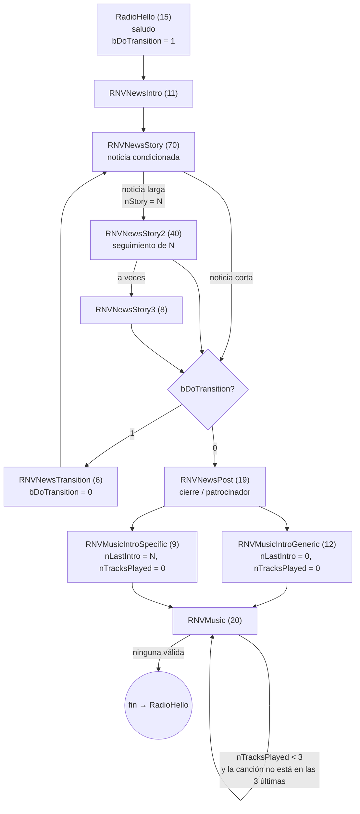

# Cómo funciona Radio New Vegas por dentro

[English version](../en/how-radio-new-vegas-works.md)

Este documento explica, a partir de los datos del propio juego (`FalloutNV.esm`, `Fallout - Voices1.bsa`, `Fallout - Sound.bsa`), cómo genera Fallout: New Vegas su emisora Radio New Vegas, y cómo lo reproduce este programa. Todo lo que viene del ESM es exacto; lo que es deducción está marcado como **[inferencia]**.

---

## 1. Resumen

Radio New Vegas no es una playlist: es **una conversación en bucle** de un *Talking Activator* (Mr. New Vegas) cuyas líneas están encadenadas por diálogos con condiciones y siete variables de control. El ciclo resultante es:

```
Saludo → Intro de noticias → Noticia 1 (+0–2 frases de seguimiento) → Transición
       → Noticia 2 (+0–2 seguimiento) → Cierre / patrocinador
       → Presentación musical ─┬─ genérica  → 3 canciones seguidas
                               └─ específica → 1 canción (la anunciada)
       → (fin de conversación) → vuelve a empezar por el Saludo
```

Restricción clave: **ninguna canción puede sonar si está entre las 3 últimas** (el historial se mantiene entre bloques).

---

## 2. Dónde está cada cosa en los archivos del juego

| Qué | Dónde | Notas |
|---|---|---|
| Lógica de la radio | `FalloutNV.esm` → QUST `RadioNewVegas` (0x0014DF04) | Script `RadioNewVegasSCRIPT` con las variables |
| Emisor | TACT `RadioNewVegasTA` (0x0014DF02) | Tipo de voz `MaleUniqueMrNewVegas`. Sin *radio template* (sin filtro de audio) |
| Diálogos | 12 DIAL de tipo **Radio** (tipo 7) + sus INFO | 216 INFO: 196 locuciones + 20 canciones |
| Canciones | `Data\Sound\songs\radionv\*.mp3`, también dentro de `Fallout - Sound.bsa` | La carpeta es compartida con otras emisoras (48 mp3). RNV usa 19 |
| Locuciones | `Fallout - Voices1.bsa` → `sound\voice\falloutnv.esm\maleuniquemrnewvegas\` | |
| Entrevistas (Swank, Primm Slim, Meyers…) | Mismo BSA, en la carpeta del tipo de voz de cada NPC (`maleadult03`, `robotprotectron`…) | Mismo patrón de nombre |

### Formatos de audio

| | Formato | Detalles |
|---|---|---|
| Canciones | MP3 | 256 kbps CBR, 44,1 kHz, estéreo (dos temas de Dead Money a 192 kbps). El BSA trae también una copia `*_mono.ogg` de cada una para las radios físicas del mundo |
| Locuciones | Ogg Vorbis | 24 kHz, mono, ~46 kbps. Cada una va acompañada de un `.lip` (sincronización labial) |

Las canciones están grabadas mucho más bajas que las voces (−28 a −34 LUFS frente a −13 a −16 LUFS), y casi todas traen entre 3 y 8 s de silencio digital al final. El juego las reproduce tal cual.

### Nombre de los archivos de voz

`<quest>_<topic>_<FormID de la INFO en 8 hex>_<nº de respuesta>.ogg`

Si `len(quest) + len(topic) > 25`, el motor trunca la quest a 10 caracteres y el topic a 15:

- `radionewvegas_rnvnewsstory_0014e7cd_1.ogg`
- `radionewve_rnvmusicintroge_0014eb17_1.ogg` (← `RadioNewVegas` + `RNVMusicIntroGeneric`)

Lo más robusto es buscar por FormID (`*_0014eb17_1.ogg`), que es lo que hace el programa.

---

## 3. Cómo lo ejecuta el motor del juego

1. El Talking Activator con la casilla *Radio Station* emite continuamente: cuando una conversación termina, empieza otra por el topic **`RadioHello`** (compartido por todas las radios; cada INFO pertenece a una quest).
2. Cada línea (INFO) tiene:
   - **Condiciones** (`CTDA`): variables de la quest, globales de la historia (`VStoryEvent*`), fases de misiones, NPC muertos, perks.
   - **Choices** (`TCLT`): topics que pueden venir a continuación.
   - **Result script**: modifica las variables de control cuando termina de sonar.
   - **Flags**: `Random` (al azar entre las líneas válidas del topic), `RandomEnd`, `RunImmediately`.
   - En las canciones, el `TRDT` apunta a un registro SOUN (el mp3) en vez de a una locución, y el texto es el título.
3. Tras cada línea se evalúan las choices; entre los topics con al menos una línea válida se elige uno y, dentro de él, una línea al azar (topic `Random`) o la primera válida.
4. Si ninguna choice tiene líneas válidas, **la conversación termina** y se vuelve al punto 1.

**[inferencia]** Cuando hay dos choices válidas a la vez (p. ej. `RNVMusicIntroGeneric` y `RNVMusicIntroSpecific`) se elige entre ellas al azar: si se cogiera siempre la primera, las presentaciones específicas no sonarían nunca, y sí suenan en el juego.

### Variables de control (`RadioNewVegasSCRIPT`)

| # | Variable | Uso |
|---|---|---|
| 1 | `nStory` | Noticia "larga" en curso → elige su seguimiento en Story2/Story3 |
| 2 | `bDoTransition` | 1 = toca transición a una 2ª noticia; 0 = toca cerrar el bloque |
| 3 | `nLastIntro` | 0 = presentación genérica; N = se anunció la canción N |
| 4–6 | `nLastTrack1..3` | Historial de las 3 últimas canciones |
| 7 | `nTracksPlayed` | Canciones seguidas en este bloque (máximo 3) |
| 8 | `bKimballMOD` | Forma de muerte del presidente Kimball (solo para la noticia) |

---

## 4. Grafo de topics



Entre paréntesis, el número de líneas. `RNVDamStory`/`RNVDamOutro` son las noticias de la batalla de la presa Hoover, enlazadas desde una noticia con `VStoryState >= 60`.

| Topic | Líneas | Condición para sonar | Siguiente | Efecto |
|---|---|---|---|---|
| `RadioHello` | 15 | — (1 requiere el perk *Yermo salvaje*) | NewsIntro | `bDoTransition = 1` |
| `RNVNewsIntro` | 11 | — | NewsStory | — |
| `RNVNewsStory` | 70 | Estado de la partida (§6) | Transition/Post, o Story2 | 33 ponen `nStory = N` |
| `RNVNewsStory2` | 40 | `nStory == N` (la primera válida) | Transition/Post, o Story3 | `nStory = 0` |
| `RNVNewsStory3` | 8 | `nStory == N` | Transition/Post | `nStory = 0` |
| `RNVNewsTransition` | 6 | `bDoTransition == 1` | NewsStory | `bDoTransition = 0` |
| `RNVNewsPost` | 19 | `bDoTransition == 0` (2 requieren *Yermo salvaje*) | IntroGeneric o IntroSpecific | — |
| `RNVMusicIntroGeneric` | 12 | — | Music | `nLastIntro = 0`, `nTracksPlayed = 0` |
| `RNVMusicIntroSpecific` | 9 | La canción anunciada no está en las 3 últimas | Music | `nLastIntro = N`, `nTracksPlayed = 0` |
| `RNVMusic` | 20 | `nTracksPlayed < 3` **y** id ∉ {últimas 3} **y** (`nLastIntro == id` **o** `nLastIntro == 0`) | Music | `nTracksPlayed += 1`, desplaza el historial |

Consecuencias:

- **Siempre hay exactamente 2 noticias por bloque**: la transición solo es válida la primera vez.
- **Presentación genérica → 3 canciones aleatorias** sin repetir las 3 últimas.
- **Presentación específica → solo suena la canción anunciada**: `nLastIntro` sigue valiendo N y ninguna otra canción cumple la condición, así que la conversación termina. Los instrumentales solo suenan tras una presentación genérica, y por eso las 9 canciones con presentación propia suenan más (~6,3 % cada una frente a ~3,9 %).
- Las 7 frases de patrocinador (Tops, Silver Rush, Primm, Gomorrah, Ultra-Luxe, Vikki & Vance, Refugio 21) están dentro de `RNVNewsPost`.
- No hay hora del día ni "Say Once": las locuciones se repiten a menudo.

---

## 5. Canciones

IDs internos de los result scripts (faltan el 11, 14, 15, 17 y 20: el sistema estaba preparado para 25).

| ID | Canción | Intérprete | Archivo | Duración | Presentación propia |
|---|---|---|---|---|---|
| 1 | Ain't That a Kick in the Head | Dean Martin | `mus_aint_that_a_kick_in_the_head.mp3` | 2:26 | sí |
| 2 | Blue Moon | Frank Sinatra | `mus_blue_moon.mp3` | 2:52 | sí |
| 3 | Jingle, Jangle, Jingle | Kay Kyser Orchestra | `mus_jingle_jangle_jingle.mp3` | 3:20 | sí |
| 4 | Love Me as Though There Were No Tomorrow | Nat King Cole | `mus_love_me_as_though_no_tomorrow.mp3` | 2:35 | sí |
| 5 | Mad About the Boy | Helen Forrest | `mus_mad_about_the_boy.mp3` | 2:09 | sí |
| 6 | Something's Gotta Give | Bing Crosby | `mus_somethings_gotta_give.mp3` | 2:02 | sí |
| 7 | Johnny Guitar | Peggy Lee | `mus_johnny_guitar.mp3` | 3:03 | sí |
| 8 | It's a Sin to Tell a Lie | The Ink Spots | `mus_its_a_sin_to_tell_a_lie.mp3` | 2:21 | sí |
| 9 | Heartaches by the Number | Guy Mitchell | `mus_heartaches_by_the_number.mp3` | 2:34 | sí |
| 10 | Why Don't You Do Right? | Peggy Lee | `mus_why_dont_you_do_right.mp3` | 3:22 | no |
| 12 | American Swing | Gerhard Trede | `mus_american_swing.mp3` | 1:35 | no |
| 13 | Hallo Mister X | Gerhard Trede | `mus_hallo_mister_x.mp3` | 2:10 | no |
| 16 | Manhattan | Gerhard Trede | `mus_manhattan.mp3` | 1:22 | no |
| 18 | Sit and Dream | Pete Thomas | `mus_sit_and_dream.mp3` | 1:30 | no |
| 19 | Slow Bounce | Gerhard Trede | `mus_slow_bounce.mp3` | 2:05 | no |
| 21 | Strahlende Trompete | Gerhard Trede | `mus_strahlende_trompete.mp3` | 3:07 | no |
| 22 | Von Spanien nach Südamerika | Gerhard Trede | `mus_von_spanien_nach_s_damerika.mp3` | 1:46 | no |
| 23 | Where Have You Been All My Life | Jeff Hooper | `mus_where_have_you_been_all_my_life.mp3` | 2:57 | no |
| 24 | Big Iron | Marty Robbins | `mus_big_iron.mp3` | 3:58 | no |
| 25 | Stars of the Midnight Range | Johnny Bond | ⚠ apunta a `mus_big_iron.mp3` | — | no |

⚠ **Bug original**: la INFO de *Stars of the Midnight Range* usa el sonido de *Big Iron*, así que en el juego *Big Iron* suena el doble. El mp3 correcto existe (lo usa Mojave Music Radio). El programa permite corregirlo o mantenerlo.

---

## 6. Noticias y estado de la partida

Las 70 noticias de `RNVNewsStory` dependen de lo que haya hecho el Mensajero:

- **Globales `VStoryEvent*`** (Hanlon, Kings, Fiends, PrimmSheriff, CaesarKilled, Kimball, BoS, Nelson, Remnants, Racket, MrHouseNeutralized…): 0 = no ha pasado, 1/2/3 = distintos desenlaces.
- **`VStoryState`**: avance de la trama principal.
- **Misiones**: `GetQuestCompleted`, `GetStage`, `GetObjectiveCompleted`.
- **`GetDead`** de NPC concretos (16 noticias).
- Solo 4 noticias no tienen ninguna condición.

Con el estado inicial (globales a 0, nadie muerto, nada completado) quedan unas **19 noticias válidas**: el "inicio de partida" (el mensajero que revive, los Fiends, HELIOS One parado, la Legión en Nelson…). Es el estado que usa el programa.

---

## 7. Cómo lo reproduce el programa

1. **Extracción** (`fnv_radio/extract.py`): lee el ESM (y sus masters), exporta la quest de cada emisora a `library/stations/<id>.json` y copia del BSA las canciones y las locuciones.
2. **Motor** (`fnv_radio/engine.py`): interpreta el grafo igual que el juego, sin codificar la secuencia a mano. Evalúa las condiciones (un `OR` se agrupa con la siguiente condición; los grupos se combinan con `AND`), ejecuta los result scripts (`set X to Y`, `set X to X + 1`) y elige con un generador aleatorio con semilla, así que la misma semilla da siempre la misma emisión.
3. **Render** (`fnv_radio/render.py`): decodifica cada pieza a PCM, las concatena con 0,35 s de pausa y codifica una sola vez con ffmpeg (WAV, MP3 256 kbps VBR u Opus 128 kbps VBR). Por defecto conserva los niveles originales del juego.

Diferencias opcionales respecto al juego: corregir el bug de *Big Iron* y no repetir la misma locución dentro de un bloque.

`tests/check_rules.py` simula 5000 bloques y comprueba las reglas de la sección 4.

---

## 8. Fuentes

- Datos del juego: `FalloutNV.esm`, `Fallout - Voices1.bsa`, `Fallout - Sound.bsa` (análisis propio).
- [Radio New Vegas – The Fallout Wiki](https://fallout.wiki/wiki/Radio_New_Vegas)
- [Radio New Vegas – Fallout Wiki (Fandom)](https://fallout.fandom.com/wiki/Radio_New_Vegas)
- [TalkingActivator – GECK Wiki](https://geckwiki.com/index.php/TalkingActivator) y [Category:Radio Stations – GECK (UESP)](https://geck.uesp.net/wiki/Category:Radio_Stations)
- [Extended New Vegas Radio Generator (Nexus 36835)](https://www.nexusmods.com/newvegas/mods/36835) y [Xoanon's No Repeat Day Radio Station (Nexus 62464)](https://www.nexusmods.com/newvegas/mods/62464)
- [Radio New Vegas Everywhere (Nexus 62555)](https://www.nexusmods.com/newvegas/mods/62555)
